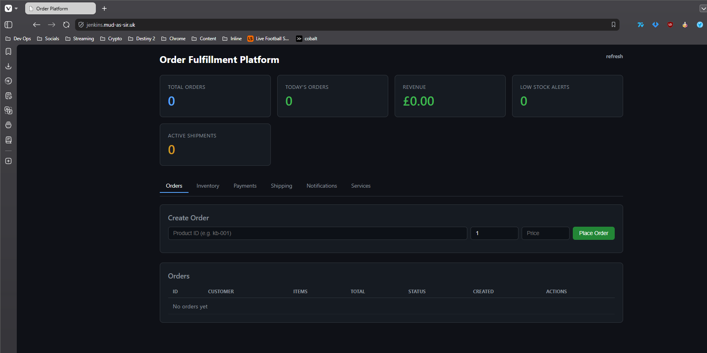
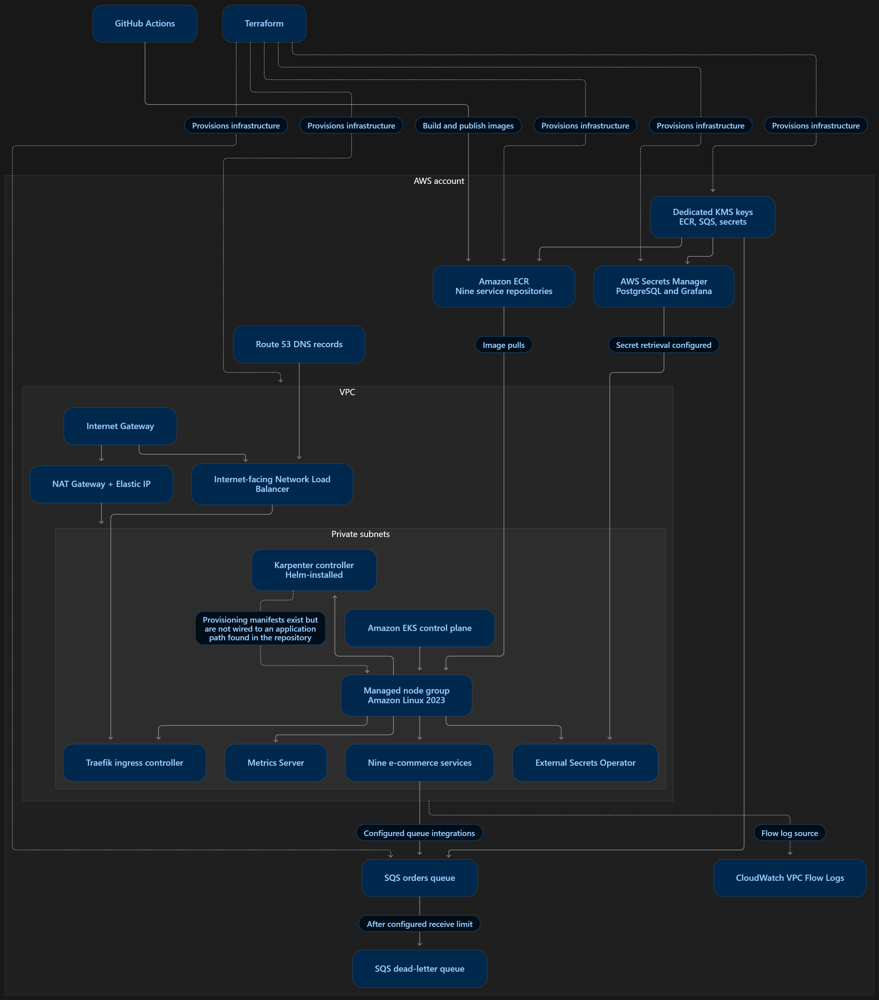
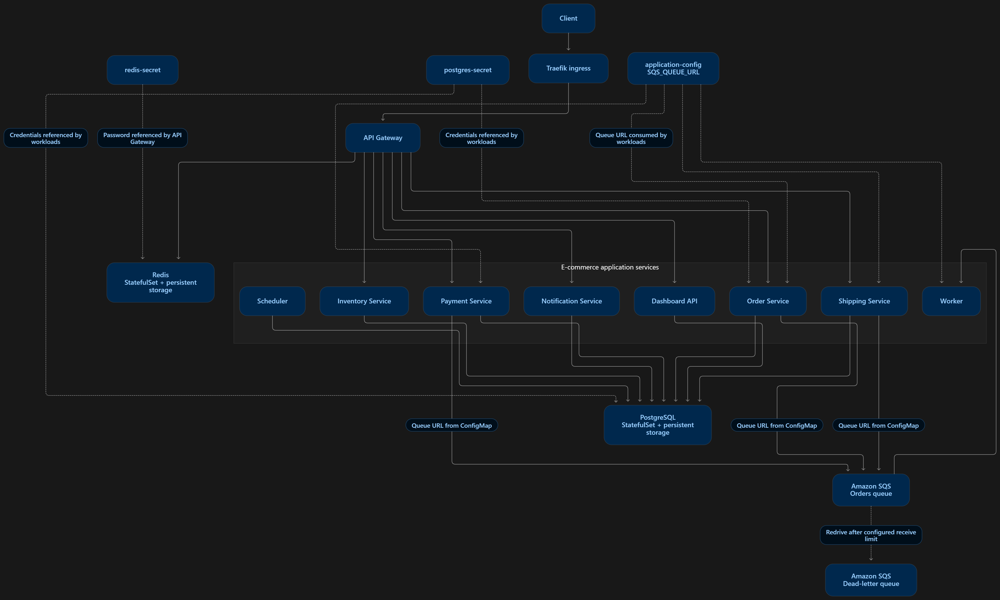
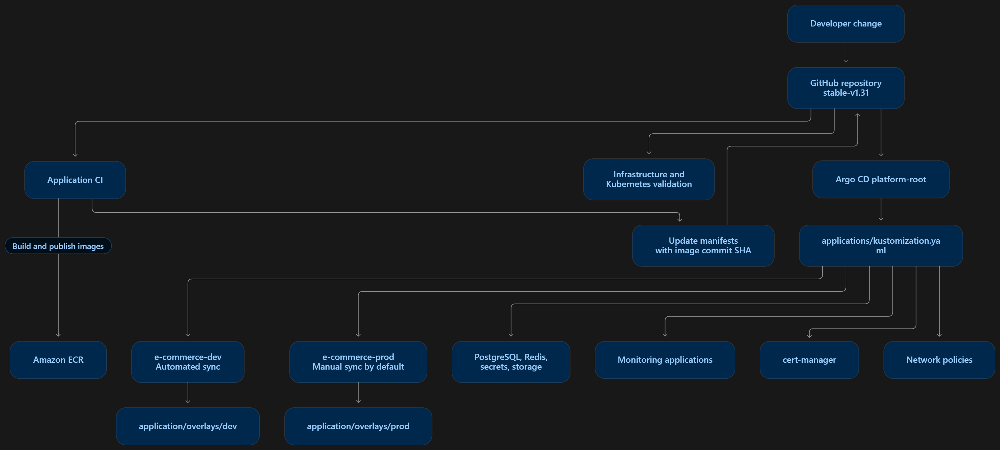

# Kubernetes E-Commerce Platform on Amazon EKS

## Application Preview

The e-commerce dashboard was accessed through the custom domain during a live deployment.



A production-inspired, cloud-native e-commerce platform built on **Amazon EKS**, using Terraform, Kubernetes, Go, Docker, Kustomize, Argo CD, GitHub Actions, AWS managed services, and an observability stack.

This project evolved from an earlier Jenkins-on-EKS deployment into a nine-service Kubernetes platform based on **The K8s Project (v2 Edition) – E-Commerce Platform**.

The goal was not simply to deploy an application. It was to build, automate, validate, troubleshoot, document, and manage the lifecycle of a cloud-native platform, from infrastructure provisioning through application delivery and infrastructure destruction.

The platform was previously deployed to EKS for live validation and subsequently destroyed to avoid unnecessary AWS costs. The repository documents the implementation; it does not imply that the environment is currently running.

---

## Project Overview

This project deploys a nine-service e-commerce platform to Amazon EKS using Terraform, Kubernetes, and GitOps.

**Key components**

- **Infrastructure:** AWS VPC, EKS, IAM, KMS, ECR, and Karpenter components provisioned with Terraform.
- **Application:** Nine Go microservices packaged as Docker images and deployed with Kubernetes.
- **Data and messaging:** PostgreSQL, Redis, Amazon SQS, and a dead-letter queue.
- **Networking:** Traefik ingress, TLS, and custom-domain routing.
- **Delivery:** GitHub Actions for CI and Argo CD with Kustomize for GitOps.
- **Observability:** Prometheus and Grafana monitoring.

The infrastructure was deployed and validated, including access to the application through its custom domain. The environment is being torn down after validation to avoid ongoing AWS costs.

## Architecture

The platform runs nine Go microservices on Amazon EKS, with PostgreSQL and Redis providing data storage and Amazon SQS handling asynchronous work. Terraform manages the AWS infrastructure, while Argo CD and Kustomize manage Kubernetes application delivery.

### AWS Infrastructure



### Application Architecture



### CI/CD and GitOps



For a more detailed explanation of the architecture and its components, see [the architecture documentation](docs/architecture.md).

### Infrastructure and Delivery

Terraform provisions the AWS infrastructure and supporting platform components. GitHub Actions validates changes and builds application images, while Argo CD reconciles Kubernetes resources from Git.

The delivery workflow follows this path:

```text
Developer changes
       |
       v
GitHub repository
       |
       v
GitHub Actions
(validate, test, build, scan)
       |
       v
Amazon ECR
(store application images)
       |
       v
Kubernetes manifests
(Kustomize overlays)
       |
       v
Argo CD
       |
       v
Amazon EKS
(run application services)
```

Terraform manages the underlying AWS infrastructure, while Argo CD manages application resources declared in Git.

---

## Project Lifecycle

1. Infrastructure design and Terraform provisioning
2. EKS platform and supporting services setup
3. Application deployment and configuration
4. CI/CD pipeline and GitOps validation
5. Monitoring, troubleshooting, and verification
6. Infrastructure teardown to control AWS costs

## Application Services

The platform consists of nine Go microservices, each deployed independently on Kubernetes.

| Service | Role | Port |
|---|---|---:|
| `api-gateway` | Entry point for application requests | 8080 |
| `order-service` | Order processing | 8081 |
| `inventory-service` | Inventory management | 8082 |
| `payment-service` | Payment processing | 8083 |
| `notification-service` | Notifications | 8084 |
| `shipping-service` | Shipping operations | 8085 |
| `dashboard-api` | Dashboard data API | 8086 |
| `worker` | Asynchronous message processing | 8090 |
| `scheduler` | Scheduled tasks | 8091 |

The service configuration includes Kubernetes Deployments and Services, resource requests and limits, readiness and liveness probes, dedicated ServiceAccounts, and multi-stage Docker builds. Horizontal Pod Autoscaling is configured for HTTP-facing services.

The reviewed Kubernetes configuration uses fixed two-replica Deployments for the worker and scheduler. The repository defines the intended service integrations; source configuration alone does not establish that every integration is operational end to end.

---

## Technology Stack

| Area | Technologies |
|---|---|
| Cloud | AWS, Amazon EKS |
| Infrastructure as Code | Terraform |
| Containers | Docker, Kubernetes |
| Application | Go |
| Networking and TLS | Traefik, AWS Network Load Balancer, cert-manager |
| Data and messaging | PostgreSQL, Redis, Amazon SQS |
| GitOps | Argo CD, Kustomize |
| CI/CD | GitHub Actions, Amazon ECR, Trivy |
| Observability | Prometheus, Grafana |

---

## Infrastructure as Code

Terraform is organized into reusable modules and separate roots for the main platform, bootstrap resources, and DNS.

### Main infrastructure

The main Terraform configuration covers:

- VPC, public and private subnets, routing, and NAT
- VPC Flow Logs
- Amazon EKS and managed node group
- IAM roles and policies
- KMS encryption keys
- Amazon ECR repositories
- Amazon SQS queue and dead-letter queue
- AWS Secrets Manager resources
- EKS add-ons and supporting platform components
- Selected Helm releases

### Terraform modules

| Module | Responsibility |
|---|---|
| `vpc` | Networking, routing, NAT, and flow logging |
| `eks` | EKS cluster and supporting configuration |
| `iam` | Infrastructure and workload identity |
| `kms` | Customer-managed encryption keys |
| `ecr` | Container image repositories |
| `sqs` | Orders queue and dead-letter queue |
| `secrets` | Secrets Manager resources |
| `argocd` | Argo CD installation |
| `karpenter` | Karpenter controller and supporting resources |

### Networking

The VPC module defines public and private subnets with separate route tables.

- Public subnets route through an Internet Gateway.
- Private subnets use a NAT Gateway for outbound internet connectivity.
- VPC Flow Logs capture accepted and rejected traffic.
- Private subnet tags support Karpenter discovery.

The configuration uses a single NAT Gateway as a cost-saving trade-off for this portfolio environment.

### Terraform state and ownership

Terraform uses remote state in Amazon S3 with native lockfile-based state locking. The repository has separate Terraform roots for:

| Root | Purpose |
|---|---|
| `terraform/` | Main infrastructure and selected platform Helm releases |
| `bootstrap/` | Initial state-backend infrastructure and GitHub Actions Terraform role |
| `terraform/dns/` | Route 53 hosted zone and Cloudflare delegation configuration |

The DNS root uses separate state and is not automatically applied by the main platform deployment script.

For detailed infrastructure architecture, module responsibilities, and Terraform workflows, see [`terraform/README.md`](terraform/README.md).

---

## Karpenter

The repository includes the Karpenter controller, supporting IAM configuration, and `NodePool` and `EC2NodeClass` manifests.

However, the source review did not establish that those custom resources are wired into the active reconciliation path. Dynamic node provisioning should therefore be treated as an intended capability until the manifest ownership and live provisioning behaviour are verified.

---

## Storage and stateful services

### PostgreSQL

PostgreSQL runs as a single-replica StatefulSet. The reviewed configuration includes:

- PostgreSQL 16.9
- A 20 GiB persistent volume
- The `gp3-retain` StorageClass
- Persistent `PGDATA` configuration
- Kubernetes Secret integration through External Secrets
- Readiness and liveness checks

### Redis

Redis runs as a single replica with persistent storage. The configuration includes:

- Redis 8.2
- A 10 GiB persistent volume
- The `gp3` StorageClass
- Append-only file persistence
- Readiness and liveness checks

### Storage classes and recovery

The platform defines two StorageClasses:

```text
gp3
  ReclaimPolicy: Delete
  Intended for ordinary persistent workloads

gp3-retain
  ReclaimPolicy: Retain
  Used for PostgreSQL storage
```

Retained EBS volumes can survive Kubernetes or EKS destruction. They must be deliberately accounted for during cleanup.

The repository includes a VolumeSnapshotClass, PostgreSQL snapshot/restore manifests, and a documented restoration procedure in [`docs/storage-restore.md`](docs/storage-restore.md).

The manifests and documentation describe the intended recovery workflow. They do not, by themselves, establish current snapshot availability, restored-data integrity, or measured recovery time and recovery-point objectives.

---

## Secrets management

The intended application secret flow is:

```text
AWS Secrets Manager
        |
        v
External Secrets
        |
        v
Kubernetes Secret
        |
        v
Application
```

The platform uses IAM, IRSA, AWS Secrets Manager, and KMS permissions to integrate secrets with Kubernetes workloads.

See [`docs/secrets-rotation.md`](docs/secrets-rotation.md) for the documented secret synchronization and rotation workflow.

### Troubleshooting example: External Secrets and IRSA

During deployment validation, PostgreSQL and application pods encountered `CreateContainerConfigError` while the External Secrets controller was unable to decrypt a required secret.

The investigation compared the existing controller pod with a newly created test pod using the same ServiceAccount. The test pod received the expected web identity environment and projected token configuration:

```text
AWS_ROLE_ARN
AWS_WEB_IDENTITY_TOKEN_FILE
aws-iam-token
```

This helped isolate the problem to the lifecycle of the existing controller pod and the timing of the IAM configuration change.

The controller was restarted and the Terraform-managed IAM configuration was updated to include the required KMS decrypt permission for the relevant key. Subsequent validation reported the ExternalSecret as synchronized and PostgreSQL as ready.

This is a documented troubleshooting outcome from the earlier deployment, not a claim about current runtime state.

---

## Event bus

Amazon SQS provides the platform's asynchronous messaging resources.

```text
Producers
    |
    v
Orders queue
    |
    v
Worker
    |
    v
Orders dead-letter queue
```

The reviewed queue configuration includes:

- 30-second visibility timeout
- Four-day message retention
- 20-second long polling
- A dead-letter queue with 14-day retention
- A maximum receive count of five before redrive

The configuration separates producer and consumer IAM roles. Producer services are configured to send messages, while the worker is configured to receive and delete messages and inspect queue attributes.

The repository defines the queue and workload configuration; successful end-to-end event processing requires independent runtime validation.

---

## Ingress, TLS, and DNS

The intended external traffic path is:

```text
Internet
    |
    v
AWS Network Load Balancer
    |
    v
Traefik
    |
    v
Kubernetes Ingress
    |
    v
api-gateway
```

Traefik is configured as a Kubernetes LoadBalancer service with an internet-facing AWS Network Load Balancer, IP target mode, a dedicated ingress class, and HTTP-to-HTTPS redirection.

TLS is configured using cert-manager and Let's Encrypt with an ACME DNS-01 challenge. The separate DNS Terraform root manages the Route 53 hosted zone and Cloudflare delegation, while ExternalDNS manages records within its configured domain filter.

The configured hostname remains `jenkins.mud-as-sir.uk`, a historical name from the earlier Jenkins project. Its presence in the configuration does not prove that the current e-commerce application is reachable through public DNS or HTTPS.

---

## GitOps and Kustomize

Argo CD manages Kubernetes resources through an App-of-Apps architecture.

```text
platform-root
├── e-commerce-dev
├── e-commerce-prod
├── postgres
├── redis
├── secrets
├── storage
├── monitoring
├── monitoring-stack
├── cert-manager
└── security
```

The root Application tracks the `stable-v1.31` branch and the definitions in `terraform/infrastructure/argocd/applications/`.

Application manifests use a base-and-overlay structure:

```text
terraform/infrastructure/application/
├── base/
└── overlays/
    ├── dev/
    └── prod/
```

Development uses automated synchronization, pruning, and self-healing. Production synchronization is manual so changes can be reviewed before they are applied.

### Troubleshooting Example: Argo CD Sync Status

During deployment, the root Application reported `OutOfSync` while remaining `Healthy`. Because production synchronization is manual, these statuses do not necessarily indicate a failure.

The deployment checks were adjusted to distinguish application health from synchronization state, avoiding false deployment failures when manual synchronization is expected.

---

## Observability

The monitoring configuration includes:

- Prometheus
- Grafana
- Alertmanager
- ServiceMonitors
- PrometheusRules
- Application dashboards
- Persistent storage definitions

The reviewed configuration specifies a 20 GiB Prometheus PVC with seven-day retention and a 5 GiB Grafana PVC.

The repository contains monitoring resources and alert rules. Runtime evidence is needed to establish that targets are being scraped, alerts are evaluated as expected, and notifications are delivered to their intended destination.

---

## CI/CD

GitHub Actions provides application CI/CD and infrastructure validation workflows. The workflows use GitHub Actions OIDC for AWS authentication rather than requiring long-lived AWS access keys.

### Application pipeline

The application workflow includes:

1. Matrix-based processing of the nine services.
2. Go linting, dependency download, build, and test steps.
3. Trivy filesystem scanning.
4. AWS authentication through OIDC.
5. ECR authentication.
6. Docker image builds and container image scanning.
7. Image pushes to ECR using Git commit SHA tags.
8. Kustomize validation and image-reference updates.
9. Git commits containing the updated manifest references.

Commit-SHA tags make images traceable to a source revision instead of relying on a mutable `latest` tag.

**Branch alignment matters:** Argo CD tracks `stable-v1.31`. A successful CI run on another branch does not automatically mean that Argo CD will deploy the updated manifests.

### Infrastructure pipeline

The Terraform workflow includes formatting and validation, linting and scanning steps, plan generation, approval, and infrastructure application. The deployment workflow uses an approval gate for infrastructure changes and is designed to apply the plan generated during the plan stage.

The repository also contains Kubernetes manifest and Kustomize validation workflows. Their presence documents the intended CI process; individual workflow results should be checked to confirm actual execution outcomes.

---

## Deployment and destruction

The repository includes automation for deployment, Argo CD validation, infrastructure destruction, and LocalStack initialization.

See [`terraform/scripts/README.md`](terraform/scripts/README.md) for detailed script behaviour and prerequisites.

### Deploy

From the repository root:

```bash
bash terraform/scripts/deploy.sh
```

The deployment script checks prerequisites and Terraform configuration, prepares bootstrap and platform plans with separate approval prompts, configures Kubernetes access, and waits for selected platform resources and application checks.

Review the intended AWS account, current state, and generated plans before approving infrastructure changes.

### Check Argo CD

```bash
bash terraform/scripts/check-argocd.sh
```

This reports discovered Argo CD applications and checks their synchronization and health according to the script's configured rules. It does not prove that every expected Application exists or that all integrations work end to end.

### Destroy

```bash
bash terraform/scripts/destroy.sh
```

The destruction workflow requires explicit confirmation and performs selected Kubernetes and AWS cleanup before applying the Terraform destroy plan.

ECR repositories and images are intentionally preserved. The separate DNS Terraform root is not automatically destroyed by the main platform teardown.

### Troubleshooting example: Terraform destruction cleanup

An earlier destruction run left the EKS control-plane log group behind after the cluster was removed. The log group was created by EKS rather than being directly managed as a normal resource in the main Terraform root.

The destruction script was updated to discover and clean up relevant EKS log groups and then check their removal.

This led to a broader operational lesson: destroying the main Terraform root does not necessarily remove every AWS resource associated with the platform. The script checks selected resource categories, but its completion message should not be interpreted as proof that every possible billable resource is absent.

### LocalStack

```bash
bash terraform/scripts/localstack-init.sh
```

This helper creates an SQS queue named `orders` in a running LocalStack environment. It belongs to the older local application setup and is separate from the nine-service EKS deployment.

---

## Validation and Project Status

The project has been deployed to EKS and validated during a previous live deployment. The environment is being destroyed to avoid ongoing AWS costs.

Validation covered the following areas:

| Area | Validation evidence |
|---|---|
| Infrastructure | Terraform formatting, validation, and plan review |
| Application | Go builds, tests, Docker builds, and Kubernetes readiness checks |
| CI/CD | GitHub Actions workflow results and image publishing |
| GitOps | Argo CD application health and synchronization checks |
| Data and messaging | PostgreSQL, Redis, and SQS configuration and readiness |
| Networking | Ingress, TLS, DNS, and HTTPS checks |
| Observability | Monitoring resources and configuration |
| Operations | Storage recovery procedures and infrastructure cleanup |

These checks describe the validation performed during project development. They do not imply that the environment is currently running or that every integration has been retested against the current working tree.

## Lessons learned

### Infrastructure as Code is more than creating resources

Terraform makes infrastructure reproducible, but resource ownership and lifecycle still matter. AWS-managed resources and controller-created resources may have cleanup behaviour that differs from directly managed Terraform resources.

### Kubernetes storage has lifecycle implications

Deleting a PVC does not necessarily mean the underlying EBS volume has disappeared. Reclaim policies, snapshots, retained volumes, and restoration procedures need to be understood when working with persistent databases.

### Workload identity and pod lifecycle matter

When investigating an AWS integration, inspect the actual workload and its identity configuration as well as the Terraform IAM resources. Existing pods may not immediately reflect every configuration change.

### GitOps changes the deployment model

Argo CD separates infrastructure provisioning from Kubernetes resource reconciliation. Git revisions, synchronization policies, and resource ownership all affect what gets deployed.

### Development and production need different workflows

Development can use automated synchronization, pruning, and self-healing. Production can use manual synchronization to create a review point before changes are applied.

### Immutable image references improve traceability

Using a Git commit SHA for an image establishes a clearer relationship between source code, container image, and Kubernetes manifest than relying on `latest`.

### Configuration is not the same as validation

A manifest documents intended behaviour. A successful runtime check establishes that behaviour under the conditions tested. This distinction matters for application integration, monitoring, storage recovery, DNS, and cleanup.

---

## Repository Structure

```text
.
├── .github/workflows/   # CI/CD workflows
├── docs/                # Project documentation
├── screenshots/         # Application and architecture evidence
├── services/            # Nine Go microservices
├── terraform/           # AWS infrastructure and Kubernetes configuration
├── dns/                 # DNS configuration
├── README.md
└── READMELEGACY.md      # Historical project documentation
```

The main directories separate application code, infrastructure, delivery automation, and project evidence.

## Further Documentation

- [Terraform documentation](terraform/README.md)
- [Deployment and utility scripts](terraform/scripts/README.md)
- [Secrets rotation guide](docs/secrets-rotation.md)
- [Storage and restore guide](docs/storage-restore.md)
- [Legacy README](READMELEGACY.md)

## CI/CD and Validation Evidence

The project uses GitHub Actions to validate application code, Kubernetes manifests, and infrastructure configuration. The following successful workflow runs were recorded on the `stable-v1.31` branch on 20 October 2026.

| Workflow | Evidence |
|---|---|
| Application CI | [View successful run](https://github.com/TheMudda6/jenkins-eks-challenge/actions/runs/39413130445) |
| Kubernetes Manifest Validation | [View successful run](https://github.com/TheMudda6/jenkins-eks-challenge/actions/runs/39413130406) |
| Validate Infrastructure | [View successful run](https://github.com/TheMudda6/jenkins-eks-challenge/actions/runs/39413130370) |

These runs provide evidence of the corresponding workflows completing successfully at the recorded commit. They do not, by themselves, establish that the current infrastructure is deployed or that every application integration has been validated.

Architecture diagrams and refreshed deployment screenshots will be added after the visual evidence has been updated and verified.


- [`terraform/README.md`](terraform/README.md) — infrastructure architecture, Terraform modules, state boundaries, and deployment workflow.
- [`terraform/scripts/README.md`](terraform/scripts/README.md) — deployment, Argo CD validation, destruction, and LocalStack scripts.
- [`docs/secrets-rotation.md`](docs/secrets-rotation.md) — secret synchronization and rotation procedure.
- [`docs/storage-restore.md`](docs/storage-restore.md) — persistent storage and restoration procedure.
- [`READMELEGACY.md`](READMELEGACY.md) — historical Jenkins-era documentation.

## Author

**Mudassir Shaikh**

DevOps / Cloud Engineering Portfolio Project

### Skills demonstrated

AWS · Amazon EKS · Terraform · Kubernetes · Go · Docker · Kustomize · Argo CD · GitHub Actions · Karpenter · Traefik · cert-manager · Let's Encrypt · Prometheus · Grafana · PostgreSQL · Redis · Amazon SQS · AWS Secrets Manager · External Secrets · Amazon ECR · IAM · IRSA · KMS · Route 53 · Cloudflare · Infrastructure automation · GitOps
