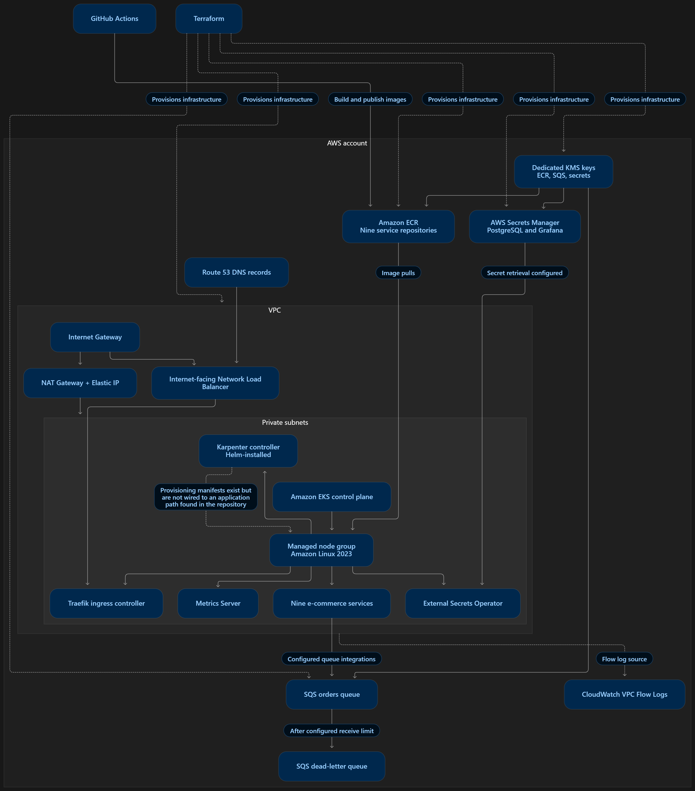
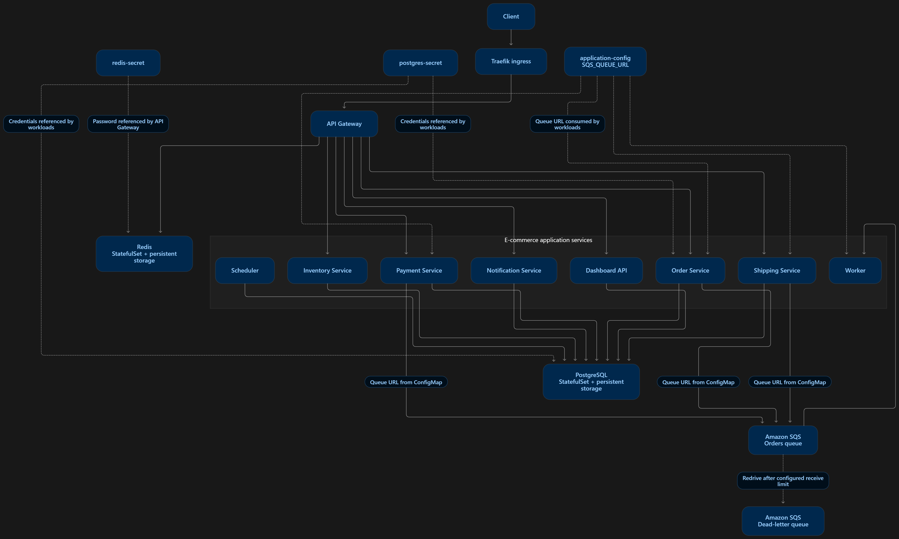
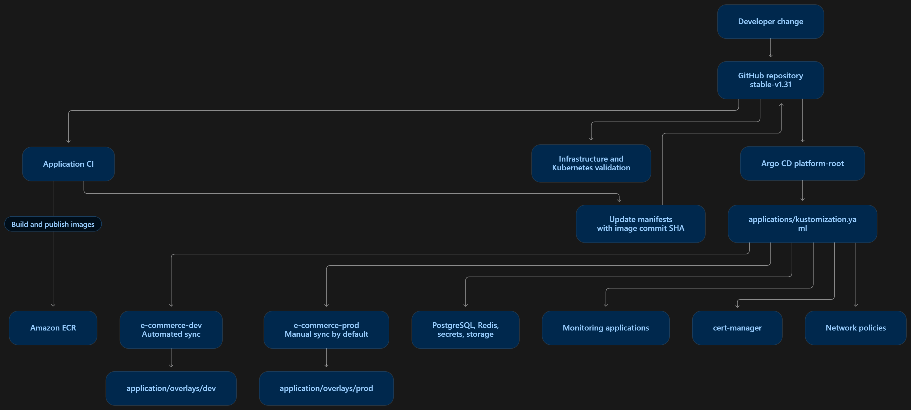

# Architecture

This document describes the intended AWS infrastructure, application
architecture, and CI/CD/GitOps workflows for the project.

The diagrams represent the configuration defined in Terraform,
Kubernetes manifests, GitHub Actions, and Argo CD. They do not
independently prove that the infrastructure is currently deployed
or that every integration has been tested.

## 1. AWS Infrastructure

## 2. Application Architecture

## 3. CI/CD and GitOps

